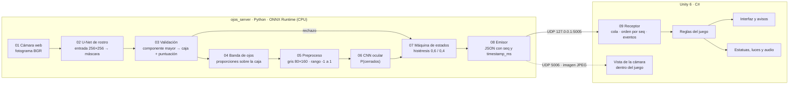
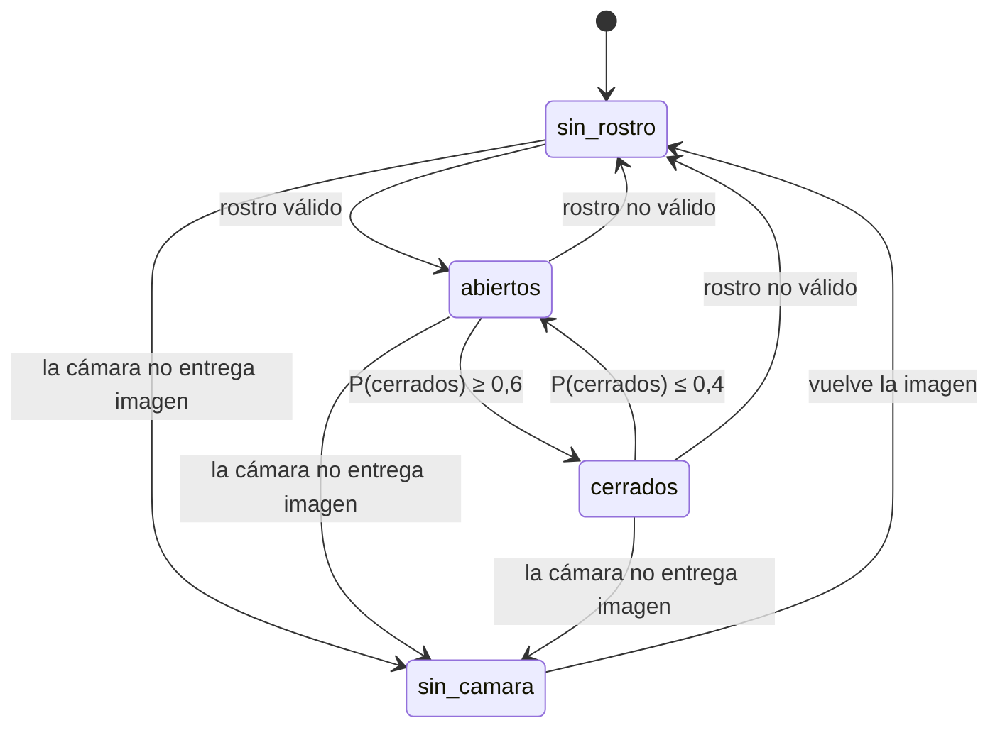

# Cuando nadie mira

**Museo virtual de mitos y leyendas de Colombia controlado con la apertura y el cierre de los ojos**

Proyecto final · Procesamiento Digital de Imágenes · 2026-2
Universidad Autónoma de Occidente (UAO) · Profesor: Nicolás Llanos Neuta

| Integrantes |
|---|
| Esteban Cifuentes Puentes|
| Juan Camilo López Sinisterra |
| Hernán Alejandro Pantoja |

---

## Contenido del proyecto

El proyecto se reparte entre este repositorio y tres carpetas de Google Drive. Los archivos que pesan más de 100 MB, y las imágenes con rostros de personas, no se publican en el repositorio.

### En este repositorio

| Contenido | Qué es |
|---|---|
| **Código fuente del juego (Unity)** | Proyecto de Unity 6 con la sala del museo, las estatuas, las reglas del juego, la interfaz, el audio y los efectos visuales, y el receptor que lee en tiempo real la señal de los ojos. |
| **Cuaderno de Colab** | Cuaderno que reúne la parte de visión computacional: calibración de la banda de ojos, construcción del conjunto de datos, entrenamiento y evaluación de la CNN, exportación a ONNX, métricas del detector, pruebas del mensaje UDP, pruebas de excepción y empaquetado de los modelos. |
| **Scripts de Python** | Servidor de ojos (cámara → modelos → UDP hacia Unity), módulo de inferencia, módulo de evaluación, grabador de datos con la webcam y pruebas automáticas. |
| **Documento del proyecto** | Informe del equipo con el planteamiento, la arquitectura y la interfaz. |
| **README.md** | Este documento. |

### En Google Drive

| Carpeta | Contenido |
|---|---|
| [**Carpeta de anexos**](https://drive.google.com/drive/folders/1tOvyKIln83t4yHYKYRT2jttsev42mdaO?usp=sharing) | La **build del juego para PC** (Windows), el **ejecutable del modelo de Python** (`ojos_server.exe`) y el **video demostrativo**. |
| [**PDI-Resultados**](https://drive.google.com/drive/folders/141yPmoISiPT59G1HgO9-4W9HzTa8t25Q?usp=drive_link) | Lo que genera el cuaderno de Colab en la carpeta `ojos_unity`: el **paquete de modelos** para el juego (`cara_unet.onnx`, `ojos_cnn.onnx`, `ojos_cnn.pth`, `config.json` y los scripts de Python), las **tablas y figuras de resultados** para el informe, y los **registros de procedencia de los datos**. |
| [**PDI-Imagenes-proyecto**](https://drive.google.com/drive/folders/1i1okoUsBdeQ5jZkltsCwhm7vx_Ug-27j?usp=drive_link) | Fotografías del proyecto, organizadas en las carpetas `Abiertos` y `Cerrados`, con las que se entrena y evalúa la CNN de los ojos. |

El conjunto de rostros con sus máscaras y los pesos de la U-Net, entrenados en el Parcial 3, están en [esta carpeta de Drive](https://drive.google.com/drive/folders/1r0P00rbqPTO4IrMLPb53Tvvhe7wozrSI) (`images`, `masks`, `images_256`, `masks_256`, `particiones.json` y `modelos/`).

---

## Tabla de contenido

1. [Descripción del proyecto](#1-descripción-del-proyecto)
2. [Arquitectura del sistema](#2-arquitectura-del-sistema)
3. [Metodología](#3-metodología)
4. [Implementación](#4-implementación)
5. [Datos](#5-datos)
6. [Interfaz gráfica de usuario](#6-interfaz-gráfica-de-usuario)
7. [Instalación y ejecución](#7-instalación-y-ejecución)
8. [Resultados](#8-resultados)
9. [Conclusiones](#9-conclusiones)
10. [Créditos, licencias y referencias](#10-créditos-licencias-y-referencias)

---

## 1. Descripción del proyecto

### 1.1 Qué es

*Cuando nadie mira* es una experiencia interactiva desarrollada en **Unity** en la que el visitante recorre un museo de mitos y leyendas de Colombia. Las esculturas del museo cambian de pose y se acercan cuando el visitante cierra los ojos, y se detienen o retroceden cuando los mantiene abiertos. La única forma de interactuar con ellas es con el gesto ocular: el cuerpo del visitante es el control del juego.

La relación con el eje del curso, el **análisis de la expresión humana en el arte y la cultura**, es la siguiente: el sistema toma un gesto expresivo del visitante (abrir o cerrar los ojos) y lo convierte en la entrada de una obra interactiva cuyo contenido es patrimonio cultural, la tradición oral colombiana. El sistema **no** reconoce quién es la persona, **no** interpreta emociones y **no** estima hacia dónde se dirige la mirada; solo distingue entre ojos abiertos y ojos cerrados.

### 1.2 Problemática

El proyecto resuelve dos problemas que dependen uno del otro.

| Dimensión | Qué se necesita | Cómo lo resuelve el proyecto |
|---|---|---|
| **Experiencia** | Que el visitante deje de ser un espectador pasivo y que su cuerpo tenga consecuencias sobre la obra. | Abrir o cerrar los ojos cambia lo que ocurre en la sala: es el control del juego. |
| **Computacional** | Convertir fotogramas de cámara muy distintos entre sí en una señal ocular confiable. | Primero se localiza el rostro; de la región del rostro sale el recorte de los ojos; si no hay un rostro válido, la interacción se detiene. |

**Por qué no basta con clasificar directamente la imagen de la cámara.** Una red convolucional puede aprender a distinguir ojos abiertos de ojos cerrados, pero solo si recibe un recorte en el que efectivamente estén los ojos. La cámara no entrega recortes: entrega el fotograma completo, con la persona, la silla, la pared y lo que haya detrás. Además, el visitante se mueve: se corre hacia un lado, se acerca o se aleja de la pantalla, inclina la cabeza o sale del encuadre. Si el sistema recortara siempre la misma zona fija, cualquier movimiento haría que la red recibiera frente, mejilla o fondo, y su respuesta dejaría de significar algo. Por eso la clasificación ocular no puede comenzar sin comprobar primero que hay un rostro y dónde está.

**Regla de diseño central.** La ausencia de un rostro válido **nunca** se interpreta como ojos cerrados. Si el visitante se agacha, se corre o sale del encuadre, el juego se pausa. Confundir la falta de información con un cierre de ojos haría avanzar a las esculturas por motivos ajenos a la voluntad del jugador y volvería injusta la experiencia.

### 1.3 Justificación

- **Cultural:** lleva mitos y leyendas colombianas a un formato interactivo, con una mecánica de juego (lo que no se mira, cambia) coherente con el carácter inquietante de esas historias.
- **Técnica:** integra en un solo sistema funcional las técnicas del curso: segmentación semántica con U-Net, clasificación con una CNN propia, extracción geométrica de regiones de interés, evaluación con métricas cuantitativas y comunicación en tiempo real con un motor de juego.
- **De interacción:** una entrada corporal (los ojos) obliga a que el sistema sea robusto ante errores y deja visible la decisión de diseño de pausar el juego cuando no hay información confiable.

### 1.4 Objetivos

**Objetivo general.** Diseñar, implementar y evaluar un sistema interactivo basado en procesamiento digital de imágenes y visión computacional que detecte si los ojos de un visitante están abiertos o cerrados y use esa señal para controlar un videojuego sobre mitos y leyendas de Colombia.

**Objetivos específicos.**

1. Entrenar un modelo propio de segmentación de rostro (U-Net) con un conjunto de datos construido por el equipo, y obtener de su máscara la caja del rostro y una puntuación de confianza.
2. Definir un procedimiento geométrico para extraer la región de los ojos a partir de la caja del rostro, sin depender de detectores de ojos o de puntos faciales preentrenados.
3. Entrenar y evaluar una CNN propia que clasifique la región ocular como abierta o cerrada.
4. Estabilizar la decisión con una máquina de estados con histéresis y comunicarla a Unity por UDP mediante un mensaje JSON con número de secuencia y marca de tiempo.
5. Construir en Unity el juego, su interfaz y las reglas que traducen la señal ocular en consecuencias dentro de la sala.
6. Evaluar el desempeño con métricas cuantitativas y evidencias visuales, y documentar las limitaciones.

### 1.5 Solución propuesta

Un programa local en Python (`ojos_server`) lee la cámara web, aplica dos modelos en serie y envía el resultado a Unity por UDP:

1. **Modelo A, U-Net de rostro.** Segmenta el rostro; de su máscara salen la caja delimitadora y la puntuación de confianza.
2. **Validación.** Acepta el rostro solo si es único, tiene tamaño suficiente y no está cortado por el borde de la imagen.
3. **Banda de ojos.** Se calcula por proporciones sobre la caja del rostro.
4. **Modelo B, CNN ocular.** Entrega la probabilidad de que los ojos estén cerrados.
5. **Máquina de estados con histéresis.** Entrega `sin_camara`, `sin_rostro`, `abiertos` o `cerrados`.
6. **Unity** recibe el mensaje, descarta lo que llegue fuera de orden y aplica las reglas del juego.

> **Relación con el planteamiento inicial.** En el informe del Avance 2 el detector se planteó como una red por cuadrícula que predice cajas. En la implementación final el modelo A es una **U-Net de segmentación de rostro**, entrenada con el conjunto de datos propio del Parcial 3, de cuya máscara se obtiene la caja. El contrato con el resto del sistema se conserva: el detector entrega una caja del rostro con una puntuación de confianza, y el resto de la cadena (validación, banda de ojos, CNN, filtro temporal y mensaje UDP) sigue lo planteado.

---

## 2. Arquitectura del sistema

### 2.1 Diagrama general



El rechazo en la validación (no hay rostro, hay varios, es demasiado pequeño o está cortado por el borde) **omite la CNN** y produce directamente el estado `sin_rostro`. Con esto la falta de rostro nunca llega a la CNN ni se confunde con un cierre de ojos.

### 2.2 Módulos de la cadena

| N.º | Módulo | Entrada | Salida |
|---|---|---|---|
| 01 | Cámara | Escena real | Fotograma BGR `uint8` |
| 02 | U-Net de rostro (`cara_unet.onnx`) | Fotograma redimensionado a 256×256, normalizado con estadísticas de ImageNet | Mapa de probabilidad de rostro (sigmoide) |
| 03 | Validación | Máscara umbralizada en 0,5 | Caja única válida + puntuación, o motivo de rechazo |
| 04 | Banda de ojos | Fotograma + caja del rostro | Recorte de proporción 2:1 o rechazo |
| 05 | Preproceso ocular | Recorte | Tensor `float32` `[1, 1, 80, 160]` en escala de grises, rango [-1, 1] |
| 06 | CNN ocular (`ojos_cnn.onnx`) | Tensor ocular | Logits `[1, 2]` → P(cerrados) |
| 07 | Máquina de estados | P(cerrados) + validez | `sin_camara` · `sin_rostro` · `abiertos` · `cerrados` |
| 08 | Emisor UDP | Estado + contadores | Datagrama JSON |
| 09 | Receptor y reglas en Unity | Datagrama JSON | Eventos y consecuencias en la sala |

### 2.3 Entrenamiento e inferencia

El entrenamiento y la inferencia son procesos separados. Los dos modelos se entrenan por separado en **Google Colab** con GPU y se exportan a **ONNX**. En el equipo de juego, `ojos_server` carga los pesos ya fijados y procesa las imágenes de la cámara sin modificar ningún parámetro, usando solo CPU.

Esta separación permite saber en qué etapa ocurre un fallo: si la caja sale mal, el problema es de la U-Net; si la caja está bien y el estado es incorrecto, el problema es de la CNN o del filtro temporal.

### 2.4 Máquina de estados



La histéresis usa dos umbrales distintos para entrar (0,6) y salir (0,4) del estado `cerrados`. Mientras la probabilidad está entre ambos se conserva el estado anterior, lo que evita que un parpadeo o un fotograma con ruido haga oscilar el estado. Cada cambio de estado se registra con su `seq`, su marca de tiempo, la probabilidad y el motivo, y puede guardarse en un archivo CSV con `--log-estados`.

### 2.5 Mensaje UDP de Python a Unity

El canal es **UDP local** (`127.0.0.1:5005`), porque en este caso importa más la latencia que la entrega garantizada: si se pierde un datagrama, el siguiente lo reemplaza pocos milisegundos después. Por eso los campos `seq` y `timestamp_ms` son obligatorios.

```json
{"seq":125,"timestamp_ms":1795588872464,"valid":true,"state":"cerrados","p":0.88,"face_score":0.977,"motivo":"ok"}
```

| Campo | Tipo | Significado |
|---|---|---|
| `seq` | entero ≥ 0 | Número creciente; permite descartar mensajes que llegan fuera de orden o repetidos. |
| `timestamp_ms` | entero | Instante de emisión; permite medir latencia y saber si el mensaje sigue vigente. |
| `valid` | booleano | Verdadero solo cuando hay un rostro aceptado y el estado ocular es utilizable. |
| `state` | `sin_camara` · `sin_rostro` · `abiertos` · `cerrados` | Estado final que usa la lógica del juego. |
| `p` | real en [0, 1] | Probabilidad de ojos cerrados que entrega la CNN. |
| `face_score` | real en [0, 1] | Confianza de la U-Net en el rostro (probabilidad media dentro de la cara). |
| `motivo` | texto | `ok`, `sin_rostro`, `rostro_pequeno`, `varios_rostros`, `rostro_cortado`, o el motivo de falla de la cámara. |

En Unity, el receptor procesa los mensajes en orden de llegada y **descarta** los que traen `seq` menor o igual al último aceptado. Si `seq` retrocede más de un umbral o hay un silencio prolongado, interpreta que Python se reinició y acepta de nuevo. Si no llegan datos durante un tiempo máximo, el juego trata la señal como perdida y se pausa.

---

## 3. Metodología

El desarrollo se organizó en las siguientes etapas.

| Etapa | Qué se hizo |
|---|---|
| 1. Conjunto de rostros | Fotografías propias de 9 personas con ojos abiertos y cerrados, con la máscara de la cara etiquetada en makesense.ai. División 70/15/15 **por persona** (Parcial 3). |
| 2. Detector de rostro (modelo A) | U-Net de `segmentation_models_pytorch` con encoder ResNet-18, ajustada con el conjunto propio. |
| 3. Caja y validación | Componente conexa más grande de la máscara → caja y puntuación; reglas de rechazo. |
| 4. Banda de ojos | Proporciones fijas sobre la caja, calibradas con revisión visual en varias fotografías. |
| 5. Conjunto de ojos | Fotografías propias etiquetadas como abiertas o cerradas; la banda se extrae con el mismo procedimiento que usa el juego. |
| 6. CNN ocular (modelo B) | CNN ligera entrenada desde cero, con variaciones leves de la imagen solo en entrenamiento. |
| 7. Evaluación | Exactitud con intervalo de Wilson, F1, matriz de confusión, cadena completa, métricas del detector, prueba del mensaje UDP y pruebas de excepción. |
| 8. Exportación | ONNX (opset 17) y verificación de equivalencia con PyTorch. |
| 9. Integración | Servidor de Python, mensaje UDP y receptor en Unity. |
| 10. Juego | Sala, estatuas, reglas, interfaz, audio y efectos en Unity. |

### 3.1 Modelo A: U-Net de rostro

| Parámetro | Valor |
|---|---|
| Arquitectura | U-Net (Ronneberger et al., 2015) con encoder ResNet-18, una sola clase («rostro») |
| Pesos iniciales del encoder | ImageNet (transferencia de aprendizaje); el decodificador y la capa de salida se entrenan con datos propios |
| Entrada | Imagen RGB redimensionada a 256×256, normalizada con media y desviación de ImageNet |
| Salida | Mapa de probabilidad de rostro (sigmoide); máscara con umbral 0,5 |
| Entrenamiento (Parcial 3) | Adam, tasa de aprendizaje 5e-4, lotes de 8, 50 épocas, reducción de la tasa en meseta, aumentos de datos solo en entrenamiento |
| Caja | Componente conexa más grande de la máscara |
| Puntuación | Probabilidad media de la U-Net dentro de la máscara |

El Parcial 3 incluyó un experimento con y sin pesos iniciales de ImageNet. Con ellos el Dice en prueba fue 0,9335, frente a 0,8035 sin preentrenar, por lo que el sistema usa la variante con ImageNet.

**Reglas de rechazo** (cada una produce `sin_rostro` y un `motivo` concreto):

| Motivo | Condición |
|---|---|
| `sin_rostro` | El área de la máscara es menor que el 0,3 % del fotograma |
| `rostro_pequeno` | El área de la caja es menor que el 3 % del fotograma |
| `varios_rostros` | Una segunda componente conexa alcanza al menos el 35 % de la primera |
| `rostro_cortado` | La caja toca el borde de la imagen |

### 3.2 Banda de ojos

La región de los ojos se calcula con proporciones fijas dentro de la caja del rostro, con un procedimiento desarrollado por el equipo:

| Parámetro | Valor |
|---|---|
| Centro horizontal (`cx`) | 0,50 del ancho de la caja |
| Centro vertical (`cy`) | 0,33 del alto de la caja |
| Ancho de la banda | 0,92 del ancho de la caja |
| Proporción del recorte | 2:1 (alto : ancho = 80 : 160) |

El recorte se pasa a escala de grises, se redimensiona a 80×160 y se normaliza al rango [-1, 1]. La calibración se revisa visualmente en el cuaderno (sección 4) y los valores quedan en `config.json`.

### 3.3 Modelo B: CNN ocular

| Parámetro | Valor |
|---|---|
| Entrada | `[1, 1, 80, 160]`, escala de grises |
| Bloques convolucionales | 3 bloques (convolución, normalización por lotes, ReLU, reducción espacial) con 32, 64 y 128 canales |
| Cabeza | Reducción promedio adaptativa a 2×4, capa densa de 64 unidades, dropout 0,4 y capa final de 2 logits |
| Optimización | AdamW con decaimiento de pesos 1e-2, suavizado de etiquetas 0,1, hasta 120 épocas |
| Aumentos | Variaciones leves de la imagen (*jitter*), **solo sobre el conjunto de entrenamiento** |
| Exportación | ONNX opset 17, ejecutado con ONNX Runtime en CPU (modelo de unos 0,6 MB) |

El índice de la clase «cerrados» se toma del mapeo de clases guardado durante el entrenamiento y nunca se supone por la posición en el tensor.

### 3.4 Evaluación

| Componente | Métricas | Protocolo |
|---|---|---|
| Detector (U-Net + caja) | Precisión, sensibilidad (*recall*), IoU medio, mAP@0,50, mAP@[0,50:0,95], tiempo por fotograma | PASCAL VOC (Everingham et al., 2010) |
| CNN ocular | Exactitud con intervalo de confianza de Wilson al 95 %, F1 por clase y macro, matriz de confusión | Conjunto de prueba separado |
| Cadena completa | Igual que la CNN, sobre fotografías completas que pasan por la U-Net y la banda; cobertura y fotografías rechazadas | Matriz de confusión con la columna «rechazada» |
| Mensaje UDP | Campos exactos, `seq` consecutivo, latencia emisor–receptor | Socket UDP real contra un receptor simulado |
| Excepciones | Estado resultante para cada escenario, con registro de cambios de estado | Escenarios reproducibles y pruebas automáticas |

---

## 4. Implementación

### 4.1 Cuaderno de Colab

El cuaderno contiene el flujo completo del lado de Python, desde la preparación de datos hasta el paquete de modelos que usa el juego:

| Sección | Contenido |
|---|---|
| 0 | Entorno, rutas de Drive y dependencias |
| 1 | Módulo de inferencia compartido |
| 2 | Carga de la U-Net entrenada en el Parcial 3 |
| 3 | Lectura de fotografías, participantes y procedencia de los datos |
| 4 | Calibración de la banda de ojos con galería en modo técnico (caja, puntuación y banda) |
| 5 | Construcción del conjunto de ojos y partición |
| 6 | Entrenamiento de la CNN |
| 7 | Evaluación de la CNN: exactitud, intervalo de Wilson, F1 y matriz de confusión |
| 7.1 | Evaluación con grabaciones de la webcam, cuando existen |
| 8 | Exportación a ONNX y verificación de equivalencia |
| 8.1 | Evaluación de la cadena completa |
| 8.2 | Métricas del detector (precisión, *recall*, IoU, mAP, tiempos) |
| 8.3 | Prueba del mensaje UDP con un socket real |
| 8.4 | Pruebas de excepción con registro de estados |
| 9 | Empaquetado: modelos, `config.json`, scripts y resultados para el informe |
| 10–11 | Uso del paquete, alcance y estado de los requisitos |

### 4.2 Scripts de Python

| Archivo | Función |
|---|---|
| `ojos_pipeline.py` | `Detector` (U-Net → validación → banda → CNN), máquina de estados, emisor, construcción y validación del mensaje UDP, dibujo del modo técnico. |
| `ojos_server.py` | Lee la cámara, ejecuta el emisor y envía el JSON por UDP; opcionalmente envía la imagen de la cámara a Unity; modos `--tecnico`, `--medir` y `--log-estados`. |
| `ojos_evaluacion.py` | Métricas de detección (IoU, precisión, *recall*, AP, mAP), Wilson, F1, matriz de confusión, escenarios de excepción, receptor simulado y partición por grupos. |
| `grabar_datos.py` | Graba recortes de ojos etiquetados con la webcam, para evaluar con datos reales. |
| `test_pipeline.py`, `test_evaluacion.py`, `test_grabador.py` | Pruebas automáticas. |

Argumentos principales de `ojos_server.py`:

| Argumento | Función |
|---|---|
| `--puerto` | Puerto UDP de destino (por defecto 5005; debe coincidir con el receptor de Unity) |
| `--camara` | Índice de la cámara o ruta de un video |
| `--carpeta` | Carpeta con `cara_unet.onnx`, `ojos_cnn.onnx` y `config.json` |
| `--tecnico` | Modo técnico: caja del rostro, puntuación, banda de ojos, `seq` y tiempos por etapa |
| `--vista-puerto` | Envía la imagen de la cámara a Unity por UDP para mostrarla dentro del juego |
| `--medir N` | Mide el tiempo por fotograma sobre N fotogramas y termina |
| `--log-estados` | Guarda en CSV cada cambio de estado |
| `--unet-cada N` | Ejecuta la U-Net cada N fotogramas y reutiliza la caja entre medias (por defecto 2) |
| `--hilos` | Hilos de CPU para ONNX Runtime |

### 4.3 Unity

El proyecto de Unity se organiza en torno a cuatro responsabilidades:

| Responsabilidad | Descripción |
|---|---|
| **Recepción de la señal ocular** | `OjosReceiver` escucha el JSON por UDP en un hilo propio, ordena por `seq`, descarta mensajes viejos o repetidos y expone el estado, la probabilidad y eventos (cerrados, abiertos, parpadeo, rostro perdido, rostro recuperado). |
| **Conexión con el modelo** | `LanzadorPython` inicia y cierra `ojos_server.exe` junto con el juego en Windows, si el ejecutable está en la carpeta `StreamingAssets/ojos_server`. |
| **Reglas del juego** | Fases (explorando, jugando, victoria, derrota), barra de progreso, estatuas con poses configurables y pausa cuando no hay rostro válido. |
| **Experiencia** | Interfaz, introducción, vista de la cámara dentro del juego, iluminación, efectos visuales (shaders), música y audio 3D. |

Se usa el **Input System** de Unity para el movimiento del jugador.

---

## 5. Datos

Las imágenes contienen rostros de personas, que son datos personales. Por esa razón **no se publican en este repositorio**; se comparten por Google Drive (ver [Contenido del proyecto](#contenido-del-proyecto)).

| Conjunto | Contenido | Uso | Ubicación |
|---|---|---|---|
| **A. Rostros y máscaras** | 80 fotografías de 9 personas (40 con ojos abiertos y 40 con ojos cerrados), con máscara de la cara etiquetada en makesense.ai. División por persona: 56 en entrenamiento, 13 en validación y 11 en prueba. | Entrenamiento y evaluación de la U-Net | [Drive (Parcial 3)](https://drive.google.com/drive/folders/1r0P00rbqPTO4IrMLPb53Tvvhe7wozrSI) |
| **B. Ojos abiertos y cerrados** | 404 fotografías: 208 de ojos abiertos y 196 de ojos cerrados, en las carpetas `Abiertos` y `Cerrados`. | Entrenamiento y evaluación de la CNN | [PDI-Imagenes-proyecto](https://drive.google.com/drive/folders/1i1okoUsBdeQ5jZkltsCwhm7vx_Ug-27j?usp=drive_link) |
| **Modelos entrenados** | `cara_unet.onnx`, `ojos_cnn.onnx`, `ojos_cnn.pth`, `config.json` | Inferencia | [PDI-Resultados](https://drive.google.com/drive/folders/141yPmoISiPT59G1HgO9-4W9HzTa8t25Q?usp=drive_link), carpeta `ojos_unity/ojos_server` |

**Uso del conjunto B con la cadena completa.** Cada fotografía pasa por la U-Net antes de recortar la banda de ojos. De las 404 fotografías, el detector aceptó 365; las 39 restantes se rechazaron por un motivo concreto: 26 por rostro cortado en el borde, 10 por rostro pequeño y 3 por varios rostros. La puntuación media de la U-Net en las caras aceptadas fue de 0,971.

**Partición sin fuga de información.** Si las fotografías de una misma persona quedan repartidas entre entrenamiento y prueba, la red puede acertar por reconocer a la persona y no el estado del ojo, y la métrica de prueba sale inflada. Por eso el conjunto A se dividió por persona. En el conjunto B, el cuaderno puede dividir por participante cuando existe un archivo `participantes.csv` (columnas `archivo` y `participante`) y, en su defecto, divide por fotografía de forma estratificada e informa en la salida qué modo se usó.

**Procedencia y protección de datos.**

- El cuaderno registra por fotografía la huella SHA-256, el tamaño y la clase en un archivo `procedencia_auto.csv`, que queda en la carpeta `ojos_unity/proteccion_datos` de PDI-Resultados.
- El tratamiento de las imágenes se enmarca en la Ley Estatutaria 1581 de 2012, que clasifica los datos biométricos como datos sensibles y exige la autorización del titular.
- El juego procesa los fotogramas en el computador local y **no los almacena** durante la experiencia.

---

## 6. Interfaz gráfica de usuario

La interfaz es el propio videojuego en Unity. No es un programa aparte que muestre resultados de visión por computador: la información técnica se traduce en luz, sonido, movimiento y avisos dentro de la ambientación del museo.

### 6.1 Reglas del juego

| Fase | Qué ocurre |
|---|---|
| **Explorando** | El visitante recorre el museo en primera persona. Parpadear solo muestra los párpados en pantalla y no afecta nada. |
| **Jugando** | **Ojos cerrados:** sube la barra «hasta el amanecer» y las estatuas avanzan una pose cada cierto tiempo. **Ojos abiertos** (tras un tiempo sostenido): la barra baja despacio y las estatuas retroceden una pose cada cierto tiempo. Mientras los ojos están cerrados pueden sonar alarmas falsas. |
| **Victoria** | La barra llega al 100 %. |
| **Derrota** | Una estatua llega a su última pose, o la barra llega a 0. |
| **Pausa** | Sin rostro válido la partida se pausa. La falta de rostro nunca se interpreta como ojos cerrados. |

Un cierre de ojos más corto que un umbral mínimo (un parpadeo) no cuenta como «cerrado».

### 6.2 Qué muestra la interfaz

| Elemento | Origen técnico | Regla de diseño |
|---|---|---|
| Barra de progreso («hasta el amanecer») | Estado `cerrados` / `abiertos` y reglas del juego | Solo cambia con una señal válida y vigente. |
| Párpados en pantalla | Eventos de cierre y apertura del receptor | Reflejan el estado ocular del visitante. |
| Aviso de rostro perdido o encontrado | `valid = false`, `sin_rostro`, o falta de datos | La escena queda visible y la partida se pausa. |
| Vista de la cámara dentro del juego | Imagen JPEG que envía Python por UDP | Ayuda a encuadrar el rostro. |
| Tensión sonora y efectos de luz | Posición de las estatuas y progreso de la barra | Hacen perceptible el peligro con los ojos cerrados. |
| Panel de victoria o derrota | Fase del juego | Permite reiniciar. |

El menú principal permite iniciar el juego y salir, y reúne la información de uso. La caja del rostro y su puntuación **no se dibujan sobre el museo durante el juego**; son información técnica que solo se muestra en el modo técnico.

### 6.3 Modo técnico

Para calibrar y depurar existe un **modo técnico** que muestra la caja del rostro con su puntuación, la banda de ojos, el `seq` y los tiempos por etapa:

- En Python: `ojos_server.exe --tecnico`, o `modo_tecnico.bat` del paquete de modelos.
- En el cuaderno: galería de la sección 4.
- Dentro de Unity, la imagen de la cámara puede enviarse con la caja y la banda dibujadas (`--vista-cajas`).

### 6.4 Evidencias visuales

La demostración del sistema funcionando está en el **video** de la [carpeta de anexos](https://drive.google.com/drive/folders/1tOvyKIln83t4yHYKYRT2jttsev42mdaO?usp=sharing), y las capturas de la interfaz y del pipeline están en el documento del proyecto. Las figuras de resultados (matrices de confusión, curva de precisión–sensibilidad, galería del modo técnico) las genera el cuaderno y quedan en `ojos_unity/informe` de [PDI-Resultados](https://drive.google.com/drive/folders/141yPmoISiPT59G1HgO9-4W9HzTa8t25Q?usp=drive_link).

---

## 7. Instalación y ejecución

### 7.1 Jugar con la build (recomendado)

La build del juego y el ejecutable del modelo pesan más de 100 MB y **no están en este repositorio**. Se encuentran en la [carpeta de anexos](https://drive.google.com/drive/folders/1tOvyKIln83t4yHYKYRT2jttsev42mdaO?usp=sharing).

**Requisitos:** Windows 10 u 11 de 64 bits, cámara web y buena iluminación sobre el rostro.

1. Descargar y descomprimir la carpeta de la build para PC.
2. Ejecutar el juego. Si `ojos_server.exe` está en la carpeta `StreamingAssets/ojos_server` del juego, se inicia solo y se cierra al salir.
3. Si el ejecutable del modelo se entrega aparte, se puede abrir a mano antes del juego (doble clic en `ojos_server.exe`); el juego escucha en el puerto UDP 5005, el mismo que usa el servidor por defecto.
4. Permitir el acceso a la cámara si Windows lo solicita.
5. Sentarse frente a la cámara con el rostro completo en el encuadre.

**Cómo se juega.** Se camina con el teclado y se mira con el mouse. **Cerrar los ojos** hace subir la barra y avanzar a las estatuas; **abrir los ojos** las hace retroceder. Las instrucciones de uso se explican dentro del menú del juego.

### 7.2 Abrir el proyecto de Unity

**Requisitos:** Unity **6.3** con soporte de compilación para Windows, Render Pipeline **URP** (los efectos de distorsión necesitan *Opaque Texture* activado) y el paquete **Input System**.

1. Clonar el repositorio.
2. En Unity Hub, **Add → Add project from disk** y elegir la carpeta del proyecto de Unity.
3. Para que el juego inicie el modelo por sí solo, copiar la carpeta `ojos_server` (con `ojos_server.exe` y los modelos) en `Assets/StreamingAssets/ojos_server/`.
4. Pulsar **Play**.

Para depurar sin el ejecutable, se puede ejecutar el servidor de Python a mano (ver 7.3); el receptor de Unity escucha en el mismo puerto.

### 7.3 Ejecutar el servidor de Python por separado

**Requisitos:** Python 3.10 o superior.

```bash
python -m venv .venv
.venv\Scripts\activate            # en Linux o macOS: source .venv/bin/activate
pip install onnxruntime opencv-python numpy
```

Descargar de [PDI-Resultados](https://drive.google.com/drive/folders/141yPmoISiPT59G1HgO9-4W9HzTa8t25Q?usp=drive_link) la carpeta `ojos_unity/ojos_server`, que contiene `cara_unet.onnx`, `ojos_cnn.onnx`, `config.json` y los scripts de Python. Desde esa carpeta:

```bash
# Servidor normal (envía a Unity por UDP, puerto 5005)
python ojos_server.py

# Modo técnico: caja del rostro, puntuación, banda de ojos y tiempos
python ojos_server.py --tecnico

# Medir el tiempo por fotograma sobre 200 fotogramas
python ojos_server.py --medir 200 --salida-medicion medicion.json

# Guardar el registro de cambios de estado
python ojos_server.py --log-estados estados.csv
```

Si los modelos están en otra carpeta, se indica con `--carpeta`.

Para las pruebas automáticas, desde la carpeta de scripts de Python del repositorio, se requiere además `pandas`:

```bash
pip install pandas
python test_pipeline.py
python test_evaluacion.py
python test_grabador.py
```

### 7.4 Reproducir el entrenamiento y la evaluación en Colab

1. Abrir el cuaderno de Colab del proyecto.
2. Elegir **Entorno de ejecución → Cambiar tipo de entorno → GPU**.
3. Verificar que las carpetas `PDI-Imagenes-Proyecto`, `PDI_Parcial3` y `PDI-Resultados` estén en el Drive que se monta en la sección 0 (las rutas del cuaderno parten de `MyDrive`).
4. Ejecutar todas las celdas en orden. Al final, el cuaderno guarda en `PDI-Resultados/ojos_unity` el paquete de modelos, las tablas y figuras de resultados y los registros de procedencia.

---

## 8. Resultados

### 8.1 Detector de rostro (U-Net + caja)

Evaluado sobre las **11 fotografías de prueba** del Parcial 3, que corresponden a 3 personas que el modelo no vio durante el entrenamiento (partición por persona).

| Métrica | Valor |
|---|---|
| Dice de la máscara (prueba) | 0,9335 |
| IoU de la máscara (prueba) | 0,8759 |
| Rostros detectados / rostros de referencia | 11 / 11 |
| Falsos positivos · falsos negativos | 0 · 0 |
| Precisión · sensibilidad (IoU ≥ 0,50) | 1,00 · 1,00 |
| IoU medio de las cajas | 0,887 |
| mAP@0,50 | 1,000 |
| mAP@[0,50:0,95] | 0,800 |
| Fotografías con IoU < 0,50 | 0 |

**Tiempo por fotograma**, medido en la CPU de Google Colab con la U-Net en cada fotograma:

| Etapa | Media (ms) | Mediana (ms) | P95 (ms) | Máx. (ms) |
|---|---|---|---|---|
| U-Net | 181,6 | 179,3 | 193,8 | 200,1 |
| Banda de ojos | 0,6 | 0,6 | 0,7 | 0,8 |
| CNN ocular | 5,6 | 4,7 | 9,0 | 9,3 |
| **Total** | **188,1** | **186,5** | **202,0** | **209,4** |

Por defecto el servidor ejecuta la U-Net cada 2 fotogramas y reutiliza la caja entre medias (`--unet-cada`), por lo que la tasa efectiva de mensajes es mayor que la que sugiere el tiempo de un fotograma completo. Con `--medir` se obtiene la misma tabla en el computador de juego.

### 8.2 CNN ocular y cadena completa

Evaluadas sobre el conjunto de prueba del conjunto B (39 fotografías: 20 de ojos abiertos y 19 de ojos cerrados), con partición estratificada por fotografía.

| Métrica | CNN con recortes ideales | Cadena completa (U-Net + banda + CNN) |
|---|---|---|
| Fotografías evaluadas | 39 | 39 |
| Exactitud | 100 % (39 de 39) | 100 % (39 de 39) |
| Intervalo de confianza de Wilson al 95 % | 91,0 % – 100 % | 91,0 % – 100 % |
| F1 macro | 1,000 | 1,000 |
| Fotografías rechazadas por el detector | — | 0 (cobertura del 100 %) |

La matriz de confusión no tiene errores en ninguna de las dos clases. Este resultado debe leerse con cautela: el conjunto de prueba es pequeño (el límite inferior del intervalo de confianza es 91 %) y la partición se hizo por fotografía, por lo que una misma persona puede aparecer en entrenamiento y en prueba. La medida más exigente es dividir por participante, que el cuaderno realiza cuando se le entrega `participantes.csv`.

### 8.3 Mensaje UDP

Prueba con un socket UDP real contra un receptor que replica la lógica de descarte del receptor de Unity, con 24 datagramas.

| Verificación | Resultado |
|---|---|
| Campos exactos de cada datagrama | Cumple |
| `seq` consecutivo | Cumple |
| Mensajes inválidos | 0 |
| Latencia emisor → receptor (equipo local) | 0,2 ms de media |
| Descarte por `seq` en Unity | Un `seq` menor o igual al último aceptado se descarta; un retroceso grande se interpreta como reinicio de Python |

### 8.4 Excepciones

La cadena trata cada caso de la misma manera: la escena vuelve a verse y las esculturas se quedan quietas. El cuaderno (sección 8.4) y las pruebas automáticas reproducen los escenarios con registro de cambios de estado.

| Caso | Causa reconocible | Respuesta del sistema |
|---|---|---|
| Ausencia de rostro | La máscara de la U-Net no alcanza el área mínima | `sin_rostro`; el juego se pausa |
| Varios rostros | Una segunda componente conexa de tamaño comparable | `sin_rostro` (`varios_rostros`); no se clasifica |
| Rostro cortado por el borde | La caja toca el borde de la imagen | `sin_rostro` (`rostro_cortado`); no se clasifica |
| Rostro demasiado pequeño | La caja ocupa menos del 3 % del fotograma | `sin_rostro` (`rostro_pequeno`); no se clasifica |
| Cámara no disponible o sin imagen | La captura falla | `sin_camara`; el juego se pausa |
| Datagrama tardío, repetido o ausente | Conexión local obsoleta o interrumpida | Unity descarta los mensajes viejos y se pausa si no llegan datos |

### 8.5 Análisis

- **Logros:** la cadena funciona de extremo a extremo (cámara → U-Net → banda → CNN → máquina de estados → UDP → Unity), y la regla de que la falta de rostro nunca se interpreta como ojos cerrados queda garantizada por construcción: los rechazos de la validación no llegan a la CNN.
- **Detector:** el modelo localiza los rostros de las personas de prueba con un IoU medio de 0,887. El conjunto de prueba es pequeño (11 fotografías de 3 personas), así que estas cifras describen el comportamiento del modelo en esas condiciones y no deben extrapolarse a cualquier cámara, luz o persona.
- **Rechazos:** al aplicar la cadena a las 404 fotografías del conjunto B, el 9,7 % se rechazó, casi todas por rostro cortado en el borde o pequeño. Es el comportamiento buscado: es preferible pausar el juego a clasificar ojos sobre una región incierta.
- **Dependencia de la caja:** la banda de ojos se estima por proporciones sobre la caja. Si la caja está corrida o la cabeza está muy inclinada, la banda puede no cubrir bien los ojos.

---

## 9. Conclusiones

**Principales resultados.**

- Se construyó un sistema funcional que integra adquisición de video, un modelo propio de segmentación de rostro, una CNN propia de clasificación ocular, un filtro temporal con histéresis y un videojuego en Unity que consume la señal en tiempo real.
- La separación en dos modelos permite localizar el origen de los fallos y evaluar cada etapa con las métricas que le corresponden.
- La decisión de pausar el juego cuando no hay un rostro válido mantiene la experiencia justa: ningún fallo técnico se traduce en el estado «ojos cerrados».
- El contrato del mensaje UDP (con `seq` y `timestamp_ms`) permite que Unity descarte datos antiguos o fuera de orden.

**Limitaciones.**

- El sistema distingue únicamente ojos abiertos de cerrados: no estima la dirección de la mirada, no reconoce personas y no interpreta emociones.
- Los conjuntos de datos son pequeños y las condiciones de luz, cámara y pose están acotadas; el desempeño en otros contextos debe medirse antes de afirmarse.
- La exactitud de la CNN se midió con 39 fotografías y partición por fotografía; está pendiente medirla con una partición por participante y con grabaciones de la webcam en el equipo de juego.
- La banda de ojos depende de proporciones fijas sobre la caja del rostro y es sensible a la inclinación y al encuadre.
- El detector se ejecuta en CPU; la velocidad depende del equipo de juego.
- La build está disponible para Windows y requiere una cámara web.
- Está diseñado para **un solo visitante** frente a la cámara.

**Oportunidades de mejora.**

- Ampliar los conjuntos de datos con más participantes, cámaras, condiciones de luz y poses.
- Estimar la banda de ojos con un modelo entrenado, en lugar de proporciones fijas.
- Evaluar sistemáticamente el sistema con datos de la webcam del equipo de juego y ajustar los umbrales de histéresis con parpadeos reales.
- Reducir la latencia de la U-Net (por ejemplo, con una entrada menor o una versión cuantizada).
- Añadir más esculturas y leyendas al museo; el juego detecta automáticamente las estatuas presentes en la escena.

---

## 10. Créditos, licencias y referencias

**Recursos del juego.**

- Tipografías: IM Fell English, Cormorant Garamond y Cinzel, con licencia SIL Open Font License.
- Modelos 3D y texturas: biblioteca [Poly Haven](https://polyhaven.com) (licencia CC0).

**Software.** Unity 6, PyTorch, `segmentation_models_pytorch`, ONNX y ONNX Runtime, OpenCV, NumPy, pandas, Google Colab.

**Referencias.**

- Congreso de la República de Colombia. (2012). *Ley Estatutaria 1581 de 2012, por la cual se dictan disposiciones generales para la protección de datos personales.*
- Everingham, M., Van Gool, L., Williams, C. K. I., Winn, J. y Zisserman, A. (2010). The PASCAL visual object classes (VOC) challenge. *International Journal of Computer Vision, 88*(2), 303–338.
- He, K., Zhang, X., Ren, S. y Sun, J. (2016). Deep residual learning for image recognition. *Proceedings of the IEEE Conference on Computer Vision and Pattern Recognition*, 770–778.
- Kaufman, S., Rosset, S., Perlich, C. y Stitelman, O. (2012). Leakage in data mining: Formulation, detection, and avoidance. *ACM Transactions on Knowledge Discovery from Data, 6*(4), 15.
- Postel, J. (1980). *User datagram protocol* (RFC 768). Internet Engineering Task Force.
- Ronneberger, O., Fischer, P. y Brox, T. (2015). U-Net: Convolutional networks for biomedical image segmentation. En *MICCAI 2015* (pp. 234–241). Springer.
